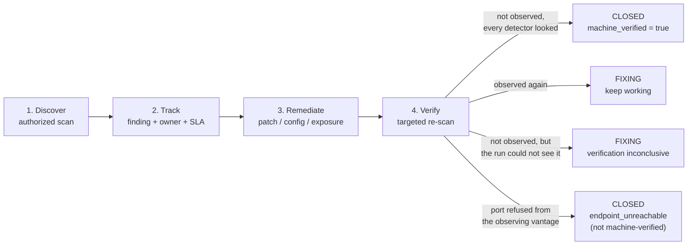

# Shapoclyack

**Self-hosted External Attack Surface Discovery & Risk-Based Vulnerability Management Platform (EASM · CAASM · RBVM).**

[](https://github.com/onixus/Shapoclyack/releases)
[](https://github.com/onixus/Shapoclyack/blob/main/requirements.txt)
[](k8s/README.md)
[](https://github.com/onixus?tab=packages&repo_name=Shapoclyack)
[](LICENSE)

Shapoclyack turns external discovery into a verifiable remediation workflow. It keeps vulnerability history attached to persistent assets instead of transient IP addresses, understands distribution security backports, makes scanning scope explicit and fail-closed, and can mechanically re-check whether a remediation actually worked.

**[Getting Started](docs/getting-started.md)** · **[Closed-loop Demo](docs/demo-remediation-loop.md)** · **[Architecture](docs/architecture.md)** · **[Web UI](docs/ui.md)** · **[Documentation](docs/README.md)** · **[Русская версия](README.ru.md)** · **[Changelog](CHANGELOG.md)** · **[Roadmap](ROADMAP.md)**

> Documentation describes `main` (`f01c2b6a`, after PR #644). The latest candidate pre-release is
> [`shapoclyack-0.49-1111-rc1`](https://github.com/onixus/Shapoclyack/releases/tag/shapoclyack-0.49-1111-rc1) (2026-11-11); see its [release notes](docs/releases/0.49-1111-rc1.md)
> (succeeding [`shapoclyack-0.48-1021`](https://github.com/onixus/Shapoclyack/releases/tag/shapoclyack-0.48-1021), [notes](docs/releases/0.48-1021.md)) and [version scope](docs/README.md#version-scope) before applying these
> instructions to a release installation.

## Why Shapoclyack

- **Persistent assets:** keep findings, ownership and remediation history attached to corroborated asset identities, enhanced with L2 discovery and native RDP X.224 perimeter observations (`octo.perimeter_observation.v1`). See [asset identity](docs/asset-identity.md).
- **Evidence of remediation & campaigns:** re-check network findings with the detectors that observed them, and group shared issues into Aggregated Problems and Remediation Campaigns (`/api/problems`, `/api/remediation-campaigns`). A closed ticket alone does not establish a verified fix. See [vulnerability lifecycle](docs/vulnerability-lifecycle.md) and [remediation campaigns](docs/remediation-campaigns.md).
- **Native Pulse v1.5.0 service probing:** execute 60+ unauthenticated read-only Rhai plugin checks (phases 1–9) across infrastructure, web services, ICS/SCADA (Modbus, EtherNet/IP, S7), and protocols (SMB, NTP, DNS, Cassandra, MSSQL, Oracle TNS, RMI, EPMD, iSCSI, DRDA, GIOP) with Pulse report schema v3 support (backward-compatible with v2). See [Pulse backend](docs/pulse-backend.md).
- **Vendor-aware patch gaps & regulatory threat mapping:** compare endpoint software with distribution advisories, Windows builds with MSRC, and map findings to FSTEC BDU threats and 187-FZ compliance frameworks. See [software matching](docs/software-cve-matching.md) and [FSTEC certification roadmap](docs/fstec-certification.ru.md).
- **Risk with context:** keep likelihood and business impact as separate axes, with exploit maturity bounds. See [risk scoring](docs/risk-scoring.md).
- **Optional AI Operator:** integrate local inference or external LLM providers (`local`, `xai`, `openrouter`, `omnirouter`, `openai_compatible`) with strict public endpoint verification and read-only MCP support. See [AI operator](docs/local-operator.md) and [AI operator providers](docs/local-operator-providers.md).
- **Distributed scanning:** sensors claim tenant-scoped work outbound over NATS JetStream or HTTPS. See [network requirements](docs/network-requirements.md).

## Closed-loop remediation at a glance



A verified closure requires evidence that every detector looked again. Missing coverage returns the finding to `FIXING`. An unreachable endpoint can close as `endpoint_unreachable` with `machine_verified = false`. See [remediation walkthrough](docs/demo-remediation-loop.md).

## Quick start

Choose an installation path; commands run from a checked repository root.

| Goal | Path | Requirements |
|---|---|---|
| Install prebuilt images on one Linux server | [Server installation](docs/server-install.ru.md) | Python 3.9+, Docker Engine, Compose v2, HTTPS reverse proxy |
| Evaluate locally with image builds | [Getting started](docs/getting-started.md) | Docker, kind, kubectl, OpenSSL, at least 4 GB free RAM; Pulse `v1.5.0` release access |
| Deploy or upgrade Kubernetes workloads | [Kubernetes / Kustomize](k8s/README.md), [Helm](docs/helm.md) | Cluster, registry access, secrets and storage config |

For a server installation without building on the host:

```bash
sudo python3 scripts/install-server.py prepare --url https://scan.example.test
# Inspect /opt/shapoclyack/compose.json, then start the prepared installation:
sudo python3 scripts/install-server.py start
```

The guide explains how to copy the standalone script without cloning the project, configure TLS, obtain the initial credentials, back up and upgrade. `prepare` configures secrets without Docker; `start` pulls images, dumps PostgreSQL, runs migrations (`0097`–`0106` up to database head `0106_saml_session_binding`), and waits for health checks while taking API traffic offline.

To fetch decoupled Rhai Pulse plugins, synchronize FSTEC BDU threat mappings, and configure L2 neighbour table limits:

```bash
./scripts/fetch-pulse-plugins.sh
python3 scripts/fetch-bdu-threats.py
sudo ./scripts/neigh-table-limits.sh
```

For local evaluation:

```bash
git clone https://github.com/onixus/Shapoclyack.git
cd Shapoclyack
scripts/dev-up.sh
curl --fail --cacert .dev-tls/ca.crt https://127.0.0.1:8080/api/health
```

Trust `.dev-tls/ca.crt` in your browser, then open **https://127.0.0.1:8080**. Demo accounts, approved scanning scope and the first scan are in [Getting started](docs/getting-started.md). Teardown: `scripts/dev-down.sh`.

Scan only infrastructure you own or are authorized to assess. A fresh installation executes no scans until an administrator approves the tenant scanning scope.

## Platform capabilities

| Area | Authoritative guide |
|---|---|
| Discovery, inventory, L2 neighbour limits, RDP X.224 observations, CMDB/AD import and ServiceNow sync | [Architecture](docs/architecture.md), [asset context](docs/asset-context.md), [Pulse backend](docs/pulse-backend.md) |
| Vulnerability triage, SLA, verification, risk acceptance | [Vulnerability lifecycle](docs/vulnerability-lifecycle.md) |
| Aggregated problems and fleet-wide remediation campaigns (`/api/problems`, `/api/remediation-campaigns`) | [Problems and remediation campaigns](docs/remediation-campaigns.md) |
| Tenants, RBAC, MFA, OIDC, SAML SLO (subject binding & request validation), SCIM and service tokens | [API and RBAC](docs/api-and-rbac.md) |
| API versions, CSV/NDJSON exports and Python integrations | [API v1 and SDK](docs/api-versioning.md) |
| Reports, FSTEC / 187-FZ compliance, BDU threat mappings and signed evidence packages | [Reports and compliance](docs/reports-and-compliance.md), [custom compliance](docs/custom-compliance.md), [FSTEC certification roadmap](docs/fstec-certification.ru.md) |
| Optional AI operator, `xai` / `openai_compatible` providers and read-only MCP | [Local AI operator](docs/local-operator.md), [AI operator providers](docs/local-operator-providers.md), [MCP](docs/mcp.md) |
| Sensor fleet, decoupled Rhai Pulse plugins and endpoint inventory | [Operations](docs/operations.md), [configuration](docs/configuration.md), [endpoint design record](Agent_plan.md) |
| APEX console routes, unified navigation tabs, 1440px multi-stage board and dark/light themes | [Web interface](docs/ui.md), [console design system](docs/console-design-system.md) |
| Operational acceptance and remaining product work | [Enterprise-readiness roadmap](ROADMAP.md#enterprise-readiness-review-epic-370) |

A **sensor** runs scans (`agent/worker.py`, API resource `agents`, `agent_kind = scanner`). An **Agent** is the Lariska endpoint inventory agent (`agent_kind = endpoint`); it does not claim scan jobs.

## Enterprise Knowledge Base (Wiki) & Role Guides

The [Russian enterprise wiki](docs/wiki/README.md) contains role playbooks, security processes and a 12-week rollout plan. Technical contracts live in [docs/README.md](docs/README.md).

Wiki sources and the sidebar are reviewed in this repository. To prepare a local GitHub Wiki preview without publishing:

```bash
scripts/publish-wiki.sh --output /tmp/shapoclyack-wiki
```

See [documentation maintenance](docs/documentation-maintenance.md) for rendering and publishing.

## Repository Layout

| Directory | Purpose |
|---|---|
| `api/` | FastAPI control plane, services (including BDU threat mappings `api/services/bdu_threats.py`) and database migrations (`0106_saml_session_binding`) |
| `scanner/` | Discovery and scanning pipeline |
| `agent/` | Remote sensor worker and updater |
| `recon/` | Go reconnaissance module |
| `web-next/` | Next.js APEX operator console |
| `k8s/` | Kustomize deployments and examples |
| `scripts/` | Installation, development, Pulse plugin/BDU fetchers and L2 tuning tooling |
| `tests/` | Python tests and integration fixtures |
| `docs/` | Operator guides, wiki, release notes and architecture decisions |

## Development & Testing

Use Python 3.11/3.12 and Node.js 26+. Follow [Development](docs/development.md) for dependency installation and infrastructure-dependent tests.

```bash
scripts/ci-lint.sh
python -m pytest tests/test_server_installer.py tests/test_agent_install_pins.py -q
```

These are focused installer checks. Full CI validation requires dedicated PostgreSQL and NATS services; see the development guide before running it.

## Releases & Container Images

Latest candidate pre-release: [shapoclyack-0.49-1111-rc1](https://github.com/onixus/Shapoclyack/releases/tag/shapoclyack-0.49-1111-rc1) ([notes](docs/releases/0.49-1111-rc1.md), Pulse `v1.5.0`, DB head `0106_saml_session_binding`, migrations `0097`–`0106`). Previous stable release: [shapoclyack-0.48-1021](https://github.com/onixus/Shapoclyack/releases/tag/shapoclyack-0.48-1021) ([notes](docs/releases/0.48-1021.md)). Full release history is tracked in [CHANGELOG.md](CHANGELOG.md).

| Image | Contents |
|---|---|
| `ghcr.io/onixus/shapoclyack-aio` | API, Web UI and scanner (includes `nuclei` patched with `go-jose/v4` `v4.1.6` for CVE-2026-116587) |
| `ghcr.io/onixus/shapoclyack-api` | API and Web UI |
| `ghcr.io/onixus/shapoclyack-scanner` | Scanner and sensor runtime (`python -m agent`, includes `nuclei` patched with `go-jose/v4` `v4.1.6`) |

Use reviewed `tag@sha256:<digest>` references in production. Installer defaults are pinned (with per-platform Pulse `v1.5.0` pins in `scripts/pulse-pinned.sha256`); a tag alone can move. Artifact verification and release policy are in the [release contract](docs/release-contract.md).

## Security & Licensing Notes

Shapoclyack is licensed under [Apache 2.0](LICENSE). See the [security policy](.github/SECURITY.md) for disclosure and supported versions, and [third-party licenses](docs/third-party.md).

The images use Pulse (`v1.5.0`) and contain no Nmap binaries or NSE data (only three images are published: `scanner`, `api`, `aio`; the last release with an `-nmap` image tag is `0.47-1009-rc1`), and the product no longer runs Nmap: configurations that name the Nmap backend or `nmap_timing` are rejected at load time, while Rhai Pulse plugins are decoupled from container layers and managed via `scripts/fetch-pulse-plugins.sh` into `service_probe.pulse.plugins_dir`. Replacement details, historical run handling and residual coverage gaps are in [Migrating off Nmap](docs/nmap-migration.md).
