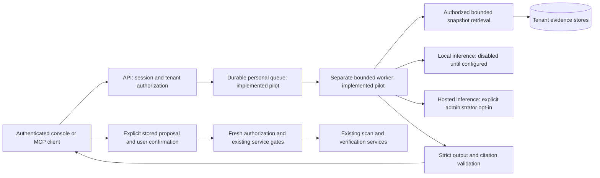

# Local Operator: architecture and delivery contract

Architecture baseline for [#584](https://github.com/onixus/Shapoclyack/issues/584),
under [EPIC #583](https://github.com/onixus/Shapoclyack/issues/583). Decision:
[ADR 0004](adr/0004-local-operator.md), with the primary Mac acceptance profile
in [ADR 0005](adr/0005-local-operator-mac-acceptance.md). Updated 2026-10-25.

## Delivery boundary

The implementation includes strict version 1 exchange contracts, an optional
inference-provider adapter, a read-only MCP adapter, durable personal sessions
and a separate queue worker ([service guide](local-operator-service.md)).
Bounded intent selection proposes server-owned typed arguments; the model never
dispatches effects. Explicit confirmed control-plane actions, deterministic
vendor remediation, published-run comparison and an authenticated console are
implemented. [Hybrid retrieval](local-operator-retrieval.md) combines exact IDs,
PostgreSQL full-text search and separately pinned local CPU embeddings.

The authenticated `GET /api/operator/status` distinguishes configuration from
live runtime readiness. With an independently pinned startup integrity manifest,
it checks local model identity/context and runtime health; without that record
it reports `not_checked`. It returns 404 while the operator is disabled. Runtime
readiness does not establish domain quality. The [quality protocol](local-operator-quality.md)
retains separate measured gates and frozen inputs. Physical NVIDIA acceptance
is tracked independently in [#609](https://github.com/onixus/Shapoclyack/issues/609);
Mac is the primary profile by the owner's decision.

Measured results, failed attempts and outstanding release gates are recorded
in the [Mac acceptance status](local-operator-acceptance-status.md). Implemented
features do not by themselves close those gates.

| Work | Issue | State / required evidence |
|---|---|---|
| Architecture, contracts and acceptance specification | #584 | Defined here; contract fixtures implemented |
| Pinned local inference runtime and model supply chain | #585 | [Primary Mac container profile](local-operator-mac.md), startup integrity/readiness and [bundle verifier](local-operator-bundle.md) implemented; measured Mac acceptance required |
| Durable sessions, queue, worker, cancellation and recovery | #586 | Durable worker and one-turn typed planner implemented; PostgreSQL concurrency/isolation/recovery tests and deployment drill harness available |
| Authorized retrieval and fixed-source citation resolution | #587 | Hybrid exact/full-text/semantic indexes implemented with source revalidation, tenant isolation, retention and deletion; measured recall gate required |
| Evidence-aware analysis | #588 | Bounded RU/EN labels and published comparison implemented; real-model domain quality unaccepted |
| Scan proposal, preview, confirmation and execution | #589 | Durable actor/session/hash-bound proposals, current native admission and no-redispatch recovery implemented; deployment drill pending |
| Remediation proposals and workflow integration | #590 | [Deterministic vendor/inventory cards](local-operator-remediation.md) implemented; sourced operational plans and full evaluation pending |
| Operator console | #591 | `/operator`: sessions, analysis, comparison, citations, actions and remediation; deployment flows remain subject to acceptance |
| Security and misuse acceptance | #592 | [Negative gate](local-operator-security.md) implemented; measured runtime network isolation and physical drills pending |
| Frozen quality and deployment acceptance | #593 | Frozen RU/EN evaluation and recovery/cold-start harnesses implemented; exact build/model/Mac report required |
| MCP read adapter | [#596](https://github.com/onixus/Shapoclyack/issues/596) | Closed after adapter/session-authorisation acceptance; documented client limitations retained |
| Local/OpenRouter/OmniRouter provider adapter | [#597](https://github.com/onixus/Shapoclyack/issues/597) | Closed for bounded adapter scope; hosted credential calls not run and not required by that scope |

## Deployment and trust boundaries

The API authenticates the actor and resolves tenant membership using the same
principal as normal routes. Client arguments, model output, retrieved text and
MCP tool arguments are untrusted. None may select a role, permissions, database
connection, tenant bypass, arbitrary URL, SQL or shell command. Source lookup
must resolve IDs inside the current tenant and return no cross-tenant existence
information. The model never receives database or service-token credentials.

The pilot worker runs separately from API request workers and scanner sensors.
Its durable record binds tenant, actor, request, source snapshot and deadline;
retries cannot change these bindings. Membership and tenant status are checked
again on execution and result retrieval. Evidence, chat and queue retention must
respect the existing tenant retention/legal-hold policy rather than invent a
parallel unlimited store. Failure to resolve a principal, source, snapshot or
policy denies the operation.

Bounded-loop design: at most 8 model turns and 16 tool calls, one inference at a
time, a 180-second job deadline, per-call timeout, bounded input/output and queue
admission. These are design ceilings for the future general loop. The delivered pilot uses
one evidence read and one inference with its own stricter deadline; see the service guide. Persist progress before dispatching each effect. Cancellation is a
durable state observed before every dispatch and after inference; it cancels
pending work and reports an already committed effect truthfully. A model timeout,
invalid structured output, worker crash or queue retry must never become an
implicit scan retry or hosted-provider fallback. The pilot includes leases, terminal-state tests and recovery to interrupted without
automatic replay. General effectful orchestration remains pending.

## Version 1 exchange contracts

Implemented in `api/services/local_operator/contracts.py`; published as the
[JSON Schema bundle](schemas/local-operator-v1.json). The schema consistency test
compares that checked-in bundle with `contract_json_schema()`; regenerate with
Python `json.dumps(contract_json_schema(), indent=2, sort_keys=True)` after
contract edits. Unknown fields and
unsupported versions are rejected; types are strict. Time values require an
offset and content hashes are lowercase SHA-256. JSON transport uses Pydantic
`model_validate_json`; native Python callers supply typed datetime/tuple values.

| Contract | Provenance and invariant |
|---|---|
| `ServerContext` | Server sets tenant, actor, request, snapshot and capture time; it is never authorization supplied by a model |
| `Citation` | Source ID/type, source hash, snapshot, observation time, current/partial/stale status; server resolves and verifies source ownership and digest |
| `AnswerPayload` | Untrusted model output: complete/empty/partial/incomplete/unknown/unsupported/stale/failed, bounded summary, citations and explicit reason for every degraded state |
| `OperatorAnswer` | Server envelope plus payload; all citations match the server-selected snapshot |
| `ToolResult` | Server context, registered tool name, outcome, data and evidence; denial/failure/cancellation/empty cannot carry successful data |
| `ActionProposal` | Server-issued proposal ID, allowlisted action, arguments/hash, expected effect, current evidence, expiry, confirmation and idempotency key |
| `ExecutionResult` | Server context, proposal/hash/key, terminal outcome and affected IDs; unsuccessful results cannot claim created resources |

A complete answer requires current evidence; duplicate citations are rejected.
An empty answer means no authorized source evidence was available and carries
no citations. Unknown means the evidence cannot determine the result; unsupported means the
requested assessment has no supported implementation; incomplete means required
observations are missing. All carry explicit reasons. Partial and stale answers
explain the limitation and cannot be
promoted to complete. The schema cannot establish citation truth or tenant
ownership: the future resolver must compare each ID, hash and snapshot with the
stored authorized evidence and reject fabricated references. Source completeness
and observation age must come from stored measurements, never model confidence.

Only `AnswerPayload` is a candidate model output. Envelopes are trusted-service
records; validating their shape does not make client-supplied tenant or actor
values trustworthy. Proposal persistence must hash canonical arguments, bind the
hash to the stored proposal and confirmation, and recompute it at execution.
The DTO itself does not implement hashing, immutable storage, replay protection
or authorization. A tool name string in a result does not register a tool.

## Tool permission and effect matrix

Existing routes/services remain authoritative. MCP tool exposure is an
allowlist, not automatic route discovery; see the MCP adapter documentation.
Implemented MCP tools are `list_runs` and `get_run_summary`, using the resolved
current tenant even for a platform administrator. Both are read only and omit
artifacts, paths, scanner configuration and arbitrary result metadata. See
[MCP configuration and transport limits](mcp.md).
The following action matrix specifies later operator tools; it does not enable
them or replace route dependencies with a generic AI permission.

| Tool family | Existing authority boundary | Effect / confirmation / replay rule |
|---|---|---|
| Assets, findings, runs and coverage reads | Authenticated current tenant principal and existing resource-read checks | Read only; bounded filters/pagination; no new evidence implies empty/partial |
| Scope and scan-policy reads | `scan_scope.read` | Read only; no scope expansion |
| Audit reads | `audit.read` | Read only; redact secrets; cap window and result count |
| Scan preview | Same tenant, target parsing, approved scope and policy checks as submission | No network probe or job creation; show exact targets, exclusions, budgets |
| Scan start | Existing operator rank plus scan admission, approved scope, policy, quotas and agent constraints; raised priority additionally needs `scan.priority.raise` | Explicit confirmation of stored arguments/hash; caller-owned idempotency; recheck gates immediately before creation |
| Scan cancel | `scan.cancel` and current job ownership | Confirm exact job; idempotent cancellation; preserve already produced evidence |
| Remediation/workflow change | Existing finding/workflow write checks; exception approval still needs `vulnerability.exception.approve` and separation of duties | Confirm exact changes; idempotency and audit; model cannot approve its own proposal |
| Scope/policy/credential/role changes, arbitrary shell/SQL/URL | Never exposed as operator tools in this baseline | Denied; no inference of authority from a prompt |

Sources include `api/auth.py`, `api/core/permissions.py`, `api/routes/jobs.py`,
`api/routes/vulnerabilities.py` and the existing submission/admission services.
Do not invent a `scan.start` named permission: current ordinary start authority
uses operator rank; named permissions supplement it for specific effects.

## Inference and egress decision

Local offline operation is the default design. The adapter is disabled by
default, and local mode accepts only its configured loopback or explicit private IP-literal endpoint. It must
not download models or fall back to a hosted provider when local inference fails.
See [provider configuration](local-operator-providers.md) for implemented settings.
OpenRouter is an explicit hosted choice; OmniRouter requires an explicit
administrator-configured compatible base URL. No service identity or hostname
is inferred from the name. Each hosted choice requires an explicit egress opt-in
and configured model/credential. Availability of a compatible endpoint is not
proof of provider policy, data residency or successful account execution.

Only bounded, authorized, minimized source content may reach a provider. Future
retrieval must remove secrets and enforce per-installation disclosure policy
before serializing messages. A connection opt-in is not a tenant-data disclosure
implementation. Never put raw credentials, provider keys or unrestricted tool
results into prompts, audit bodies or error text. Provider/model and source
snapshot must be visible in the future answer audit trail. Configured-provider
failure must be reported as failure, without silent provider switching.

## Frozen acceptance target

Candidate baseline: **Qwen3.5-9B, language-only, GGUF Q4_K_M, 8192-token context,
one inference at a time, CPU embeddings**, Linux with CUDA and an **8 GiB GPU**.
This is an acceptance target, not a verified fit or a throughput claim. Runtime
work must pin upstream model revision, license, exact GGUF SHA-256, chat template,
runtime build/image digest, context/output limits and embedding revision/hash.
The model name alone does not pin any artifact.

Before final acceptance, freeze a tenant-isolated evaluation corpus and scorer,
including full, empty, partial and stale evidence, multilingual requests,
malicious retrieved text, cross-tenant IDs, revoked membership, cancellation,
replay and unavailable providers. Do not tune thresholds after viewing final
results. Minimum release targets are tool-selection accuracy **>=95%**,
answer quality **F1 >=0.85**, citation precision **>=0.98**, **100%** of fixed-version claims supported by authoritative sources, **p95 first response <=30 seconds** and
**p95 typical task completion <=120 seconds**. Record sample counts, definition
of a correct tool/answer/citation, warm/cold split, concurrency, prompt/source
lengths, errors and timeouts; include failures in denominators and timings.

The hardware report must name GPU SKU and driver, CUDA/runtime versions, CPU,
RAM, VRAM peak, quantized model digest, context/KV-cache settings, embedding
load, cold/warm latency and out-of-memory behavior. Report measured results on
that hardware separately from contract tests, HTTP mocks and CI. The source
contracts currently have deterministic fixtures; no quality, latency, GPU-fit,
air-gap installation or live hosted-provider acceptance is claimed.
